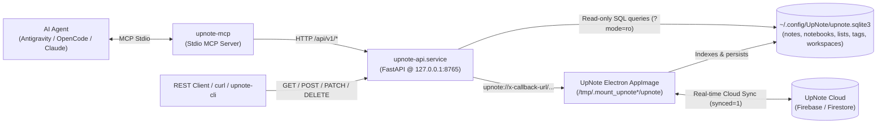

# UpNote Local Store, Deep-Link REST API & MCP Server (`upnote-api`)

[](https://github.com/russellmilliner/upnote-api/releases/tag/v0.2.2)
[](https://github.com/russellmilliner/upnote-api/releases/download/v0.2.2/upnote-api-v0.2.2-linux-x86_64.tar.gz)
[](#-model-context-protocol-mcp-server-upnote-mcp)
[](docs/SWAGGER.md)
[](https://fastapi.tiangolo.com/)
[](https://www.python.org/)
[](https://www.kernel.org/)
[](LICENSE)
[](https://ko-fi.com/russellmilliner)

> **Full REST API service (`FastAPI` + `Uvicorn`), Model Context Protocol (MCP) server (`upnote-mcp`), Swagger/OpenAPI 3.1 suite, and CLI client (`upnote-cli`) for interacting with [UpNote](https://getupnote.com/)'s local SQLite store and Electron `x-callback-url` deep-link engine on Linux.**

---

## 🎯 Why `upnote-api`?

UpNote on Linux stores its local data in `~/.config/UpNote/upnote.sqlite3` and synchronizes state with UpNote Cloud (Firebase/Firestore) inside its running Electron process (`upnote.appimage`):

1. **Direct SQLite writes do not sync to UpNote Cloud** because UpNote's Electron renderer maintains its own in-memory store and sync queue.
2. **Standard `xdg-open "upnote://..."` calls from scripts or background services fail** under Wayland/X11 session boundaries when `XAUTHORITY`, `WAYLAND_DISPLAY`, or `DISPLAY` are absent.
3. **Standard `upnote://x-callback-url/...` dispatches steal desktop window focus** because UpNote's Electron main process (`dist/electron/main.js`) calls `mainWindow.show()` whenever `!url.toLowerCase().includes('new_window=true')`.
4. **Putting `#tag` inside the Markdown `text` body of `upnote://x-callback-url/note/new` renders plain text** (`<div>#tag</div>`, `tagLinks: []`) rather than a native UpNote hashtag (`<a data-upnote-tag="#tag">`).

**`upnote-api`** solves all four problems cleanly:
* **Fast Read Queries (`GET`)**: Reads workspaces (`General`, `CHEP`, etc.), nested notebooks, tags, filters, files, and notes directly from `~/.config/UpNote/upnote.sqlite3` in read-only mode (`?mode=ro`), resolving notebook membership from `lists` (`notebooks_<uuid>`) and `organizers`.
* **Silent, Cloud-Synced Background Mutations (`POST`, `PUT`, `PATCH`, `DELETE`)**: Automatically discovers the running UpNote AppImage process and desktop session environment (`/proc/<pid>/environ`), auto-launches UpNote minimized to the system tray (`--auto-start-in-background`) if needed, and dispatches `upnote://x-callback-url/...` commands with `&_bg_new_window=true`—which satisfies `main.js`'s substring check to suppress `mainWindow.show()` (preventing focus stealing) while leaving `searchParams.get('new_window')` unset in `renderer.js` so no secondary detail window pops up. Polls SQLite until the new/updated record is indexed and synced to UpNote Cloud (`synced = 1`).
* **Multi-Tag & Non-Wrapping Code Block Support**: Converts Markdown fenced code blocks (` ``` `) into UpNote `<pre spellcheck="false">` blocks (which never wrap lines) and injects native `<a data-upnote-tag="#...">` anchors when attaching multiple tags to a note.
* **Native Model Context Protocol (MCP) Server (`upnote-mcp`)**: Exposes token-efficient, structured MCP tools (`upnote_search_notes`, `upnote_get_note`, `upnote_create_note`, `upnote_update_note_safe`, etc.) with built-in non-destructive note merging for AI agents (`antigravity-cli`, Antigravity IDE, OpenCode, Claude Code, and local Ollama agents).

---

## 🏗 Architecture



---

## 🤖 Model Context Protocol (MCP) Server (`upnote-mcp`)

[`src/upnote_mcp.py`](src/upnote_mcp.py) (`~/.local/bin/upnote-mcp` / `~/.local/share/upnote-api/upnote_mcp.py`) provides a native Model Context Protocol (MCP) server wrapping `upnote-api.service`.

### Why Use `upnote-mcp` Instead of Shelling Out to `curl`?
1. **Zero Bash / Quote Escaping Overhead**: Pass multi-line Markdown notes containing fenced code blocks, backticks, and quotes as native JSON arguments without bash escaping errors.
2. **Token-Efficient Output**: Strips duplicate HTML blobs from note search/get responses, returning only clean Markdown `text` and compact metadata.
3. **Guaranteed Non-Destructive Updates (`upnote_update_note_safe`)**: Automatically fetches the existing note content, strips duplicate leading title headers, appends or merges new sections, and performs a `cloud_replace` update so prior documentation is never lost.

### Exposed MCP Tools

| Tool Name | Arguments | Description |
| :--- | :--- | :--- |
| `upnote_status` | *(none)* | Get service health, running UpNote Electron PID, and SQLite database counts |
| `upnote_list_spaces` | *(none)* | List all workspaces (`General`, `CHEP`, etc.) and counts |
| `upnote_list_notebooks` | `space="General"`, `query=""` | List or search notebooks with nested paths (`Parent/Child`) and note counts |
| `upnote_list_tags` | `space="General"`, `query=""` | List all hashtags (`#tag`) with active note counts |
| `upnote_search_notes` | `query=""`, `notebook=""`, `tag=""`, `space="General"`, `include_content=False` | Search and filter notes with compact summaries |
| `upnote_get_note` | `note_id_or_title`, `space="General"` | Retrieve full Markdown `text`, `notebooks`, and `tags` by UUID or exact title |
| `upnote_create_note` | `title`, `text`, `notebook="AI"`, `tags=None`, `space="General"` | Create a new cloud-synced Markdown note |
| `upnote_update_note_safe` | `note_id`, `append_markdown=""`, `full_replacement_markdown=""`, `title=""`, `notebook=""`, `tags=None`, `space="General"` | Non-destructively append a new section or replace merged Markdown on an existing note |
| `upnote_trash_note` | `note_id` | Move a note to UpNote Trash |
| `upnote_restore_note` | `note_id` | Restore a trashed note from UpNote Trash |

### Configuring in Google Antigravity (`~/.gemini/config/mcp_config.json`)
```json
{
  "mcpServers": {
    "upnote": {
      "command": "/home/millinr/.local/share/agy-mcp/.venv/bin/python",
      "args": [
        "/home/millinr/.local/share/upnote-api/upnote_mcp.py"
      ]
    }
  }
}
```

### Configuring in OpenCode (`~/.config/opencode/opencode.json`)
```json
{
  "mcp": {
    "servers": {
      "upnote": {
        "type": "local",
        "command": [
          "/home/millinr/.local/share/agy-mcp/.venv/bin/python",
          "/home/millinr/.local/share/upnote-api/upnote_mcp.py"
        ]
      }
    }
  }
}
```

---

## 📚 OpenAPI 3.1 & Swagger Documentation

When `upnote-api.service` is running, full interactive API documentation is served locally:

| Interface | URL / File | Description |
| :--- | :--- | :--- |
| **Swagger UI (Interactive)** | `http://127.0.0.1:8765/docs` | Interactive Swagger UI to browse schemas and test every endpoint live |
| **ReDoc UI** | `http://127.0.0.1:8765/redoc` | Clean, three-panel ReDoc API reference documentation |
| **Live OpenAPI 3.1 JSON** | `http://127.0.0.1:8765/openapi.json` | Live machine-readable OpenAPI 3.1.0 specification |
| **Static OpenAPI 3.1 JSON** | [`docs/openapi.json`](docs/openapi.json) | Static OpenAPI 3.1.0 specification committed to the repository |
| **Markdown Swagger Reference** | [`docs/SWAGGER.md`](docs/SWAGGER.md) | Complete Markdown documentation of all endpoints, parameters, and schemas |

To regenerate [`docs/openapi.json`](docs/openapi.json) and [`docs/SWAGGER.md`](docs/SWAGGER.md) after modifying [`src/upnote_api.py`](src/upnote_api.py):

```bash
./scripts/export-openapi.py
```

---

## 🚀 Installation & Systemd Service Management

### Quick Install
Run the bundled installer script to install the service into `~/.local/share/upnote-api/upnote_api.py`, install the MCP server to `~/.local/share/upnote-api/upnote_mcp.py` (`~/.local/bin/upnote-mcp`), install the CLI to `~/.local/bin/upnote-cli`, and enable + start `upnote-api.service`:

```bash
git clone https://github.com/russellmilliner/upnote-api.git
cd upnote-api
./scripts/install.sh
```

### Managing `upnote-api.service`

```bash
# Check service status
systemctl --user status upnote-api.service

# Restart service
systemctl --user restart upnote-api.service

# Follow live service logs
journalctl --user -u upnote-api.service -f
```

### Environment Variables

| Variable | Default | Description |
| :--- | :--- | :--- |
| `UPNOTE_API_HOST` | `127.0.0.1` | Bind address for the FastAPI/Uvicorn server |
| `UPNOTE_API_PORT` | `8765` | TCP port for the REST API server |
| `UPNOTE_DB_PATH` | `~/.config/UpNote/upnote.sqlite3` | Path to UpNote's local SQLite database |
| `UPNOTE_APPIMAGE_PATH` | `~/AppImages/upnote.appimage` | Path to the UpNote AppImage binary |
| `UPNOTE_LAUNCH_SCRIPT` | `~/.local/bin/upnotelaunch.sh` | Background launcher script if UpNote is not running |
| `UPNOTE_API_URL` | `http://127.0.0.1:8765` | Base URL used by `upnote-cli` and `upnote-mcp` |
| `UPNOTE_API_TOKEN` | *(empty — disabled)* | Optional bearer/API-key token (`Authorization: Bearer <token>` or `X-API-Key: <token>`) |
| `UPNOTE_CORS_ORIGINS` | `http://127.0.0.1:8765,http://localhost:8765` | Comma-separated list of allowed CORS origins |

---

## 🔌 REST API Endpoints Overview

| Category | Method | Endpoint | Description |
| :--- | :---: | :--- | :--- |
| **System** | `GET` | `/health` | Health check & store summary |
| **System** | `GET` | `/api/v1/status` | Service version, UpNote PID/binary, and total counts across `upnote.sqlite3` |
| **System** | `POST` | `/api/v1/app/launch` | Ensure the UpNote background Electron process is running |
| **System** | `POST` | `/api/v1/app/open` | Open a note, notebook, tag, or raw `upnote://` URL in the desktop UI |
| **Spaces** | `GET` | `/api/v1/spaces` | List all workspaces (`General` / `default` and custom spaces like `CHEP`) with counts |
| **Spaces** | `GET` | `/api/v1/spaces/{space}` | Get space details by name (`General`, `CHEP`) or UUID (`default`, `<uuid>`) |
| **Notebooks** | `GET` | `/api/v1/notebooks` | List/search notebooks (`?space=General&q=AI`) with nested paths (`Parent/Child`) and `note_ids` |
| **Notebooks** | `GET` | `/api/v1/notebooks/{notebook}` | Get notebook by UUID, title (`AI`), or nested slash path |
| **Notebooks** | `GET` | `/api/v1/notebooks/{notebook}/notes` | List all active notes inside a notebook in UpNote's exact list order |
| **Notebooks** | `POST` | `/api/v1/notebooks` | Create a new notebook in the target `space` and sync to UpNote Cloud |
| **Tags** | `GET` | `/api/v1/tags` | List all hashtags (`#tag`) with active note counts (`?space=General&q=plex`) |
| **Tags** | `GET` | `/api/v1/tags/{tag}/notes` | List all active notes carrying `#<tag>` |
| **Notes** | `GET` | `/api/v1/notes` | Search (`q`) and filter notes by `space`, `notebook`, `tag`, `trashed`, `pinned`, `bookmarked`, `has_todo`, `is_template`, `unsynced`, `include_content` |
| **Notes** | `GET` | `/api/v1/notes/{note_id_or_title}` | Get a single note (including full `text`, `html`, `notebooks`, and `tags`) by UUID or exact title |
| **Notes** | `POST` | `/api/v1/notes` | Create a new note with `title`, `text` (Markdown), `space`, `notebook`, and `tag`/`tags`, synced to UpNote Cloud |
| **Notes** | `PUT` / `PATCH` | `/api/v1/notes/{note_id}` | Update a note (`strategy="cloud_replace"` creates a synced replacement and trashes the old revision; `strategy="sqlite_direct"` updates SQLite in place) |
| **Notes** | `DELETE` | `/api/v1/notes/{note_id}` | Move a note to UpNote Trash (`?permanent=true` marks `deleted=1` in SQLite) |
| **Notes** | `POST` | `/api/v1/notes/{note_id}/restore` | Restore a trashed note from UpNote Trash |
| **Filters & Files** | `GET` | `/api/v1/filters` | List saved custom filters |
| **Filters & Files** | `GET` | `/api/v1/files` | List file attachments tracked in UpNote |

---

## 💻 CLI Usage (`upnote-cli`)

```bash
# Check service status & database counts
upnote-cli status

# List spaces, notebooks, and tags
upnote-cli spaces
upnote-cli notebooks --space General
upnote-cli notebooks --space General --q AI
upnote-cli tags --space General

# Search or list notes
upnote-cli notes --space General --notebook UpNote
upnote-cli notes --space General --notebook AI --tag plex
upnote-cli notes --q "proxmox"

# Get full note content by exact title or UUID
upnote-cli get "Plex Space Fix" --space General --notebook AI

# Create a new Markdown note (from inline text, file, or stdin)
upnote-cli create \
  --space General \
  --notebook AI \
  --title "Plex Space Fix" \
  --tag plex \
  --text "### Summary\n```bash\npct resize 104 rootfs 32G\n```"

upnote-cli create \
  --space General \
  --notebook UpNote \
  --title "UpNote API" \
  --file ./README.md

# Move a note to Trash or restore it
upnote-cli trash <note_id>
upnote-cli restore <note_id>
```

---

## 🌐 Direct HTTP / `curl` Examples

### 1. Create a Note with Markdown, Non-Wrapping Code Blocks & Tags
```bash
curl -s -X POST http://127.0.0.1:8765/api/v1/notes \
  -H "Content-Type: application/json" \
  -d '{
    "title": "Plex Space Fix",
    "space": "General",
    "notebook": "AI",
    "tags": ["plex"],
    "markdown": true,
    "text": "### Summary\n```bash\npct resize 104 rootfs 32G\npct fstrim 104\n```"
  }'
```

### 2. Query Notes by Space, Notebook, Tag, or Search Text
```bash
# Filter by space + notebook + tag
curl -s "http://127.0.0.1:8765/api/v1/notes?space=General&notebook=AI&tag=plex"

# Full-text search across all notes
curl -s "http://127.0.0.1:8765/api/v1/notes?q=proxmox&include_content=true"
```

### 3. Update an Existing Note (Cloud-Synced Replacement)
```bash
curl -s -X PATCH http://127.0.0.1:8765/api/v1/notes/01a160c3-3d2c-7005-afcd-5fa869e923a5 \
  -H "Content-Type: application/json" \
  -d '{
    "tags": ["plex", "homelab"],
    "strategy": "cloud_replace"
  }'
```

### 4. Move to Trash & Restore
```bash
# Move note to Trash
curl -s -X DELETE http://127.0.0.1:8765/api/v1/notes/01a160c3-3d2c-7005-afcd-5fa869e923a5

# Restore note from Trash
curl -s -X POST http://127.0.0.1:8765/api/v1/notes/01a160c3-3d2c-7005-afcd-5fa869e923a5/restore
```

---

## 📄 License

Licensed under the [Apache License, Version 2.0](LICENSE).
Copyright © 2026 [Russell Milliner](https://github.com/russellmilliner).
